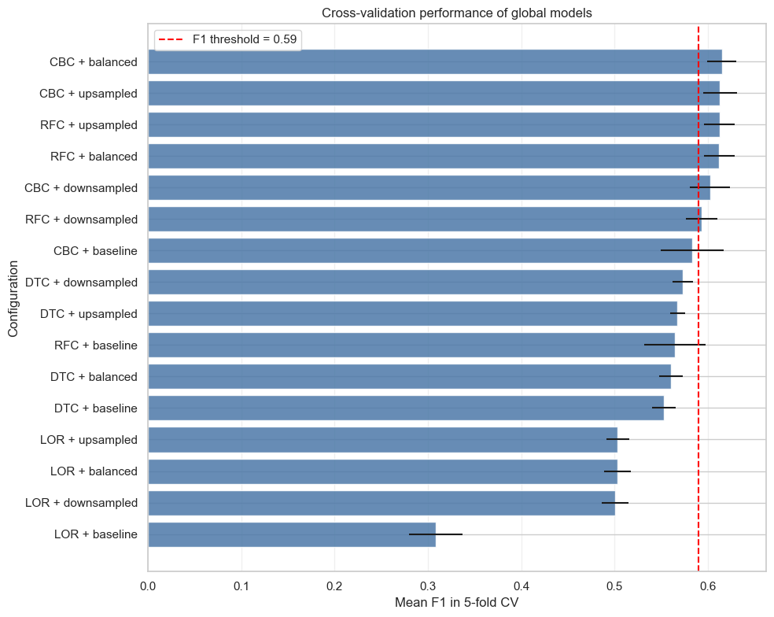
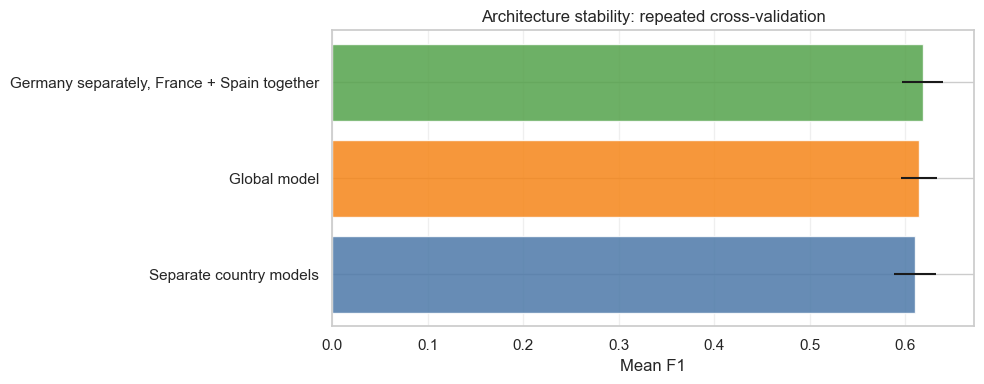
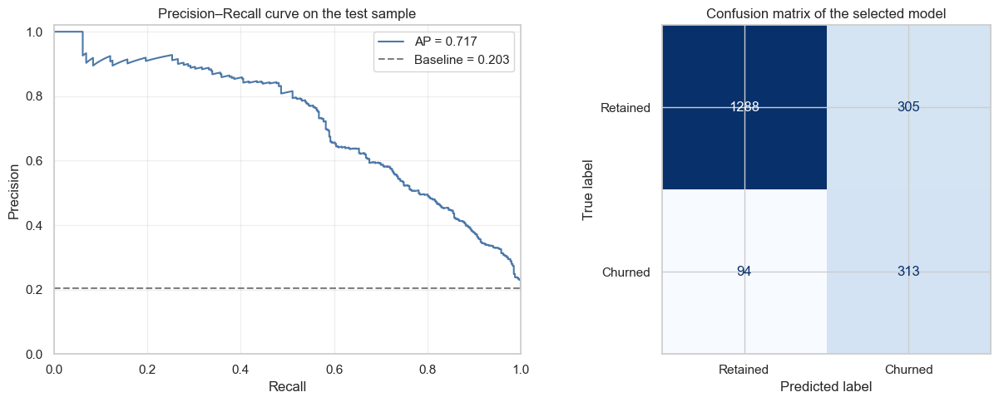
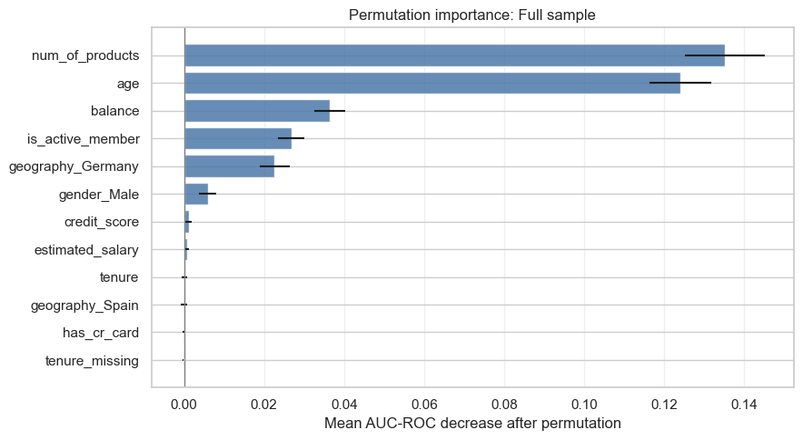

# Bank Customer Churn Prediction

Machine-learning project for predicting bank customer churn and comparing global and regional modelling architectures.

The project covers exploratory data analysis, leakage-safe cross-validation, class-imbalance handling, hyperparameter selection, architecture stability assessment, final test evaluation, and model interpretation.

## Business objective

The objective is to identify customers with a high risk of churn so that the bank can prioritize retention activities. The primary model-selection metric is the **F1 score**, with a required test threshold of **0.59**. AUC-ROC and Average Precision are used as complementary ranking metrics.

## Dataset

The dataset contains 10,000 customer records and includes demographic information, account balance, credit score, product usage, activity status, estimated salary, and the binary churn target `Exited`.

- Original source: [Bank Customer Churn Modeling on Kaggle](https://www.kaggle.com/barelydedicated/bank-customer-churn-modeling)
- Target: `Exited`
- Positive class: customer left the bank
- Countries represented: France, Germany, and Spain

The dataset itself is not redistributed in this repository. The notebook first looks for `/datasets/Churn.csv` and otherwise downloads the file from the public course mirror specified in the loading cell. See [`data/README.md`](data/README.md) for details.

## Methodology

### Data preparation and exploration

- validated data types, missing values, duplicates, and feature ranges;
- preserved the original missingness of `Tenure` with an indicator feature;
- examined distributions, outliers, target imbalance, and country composition;
- measured nonlinear associations using Phi_K;
- compared churn patterns globally and separately by country.

### Model development

Four classification algorithms were evaluated:

- Decision Tree;
- Random Forest;
- Logistic Regression;
- CatBoost.

Each algorithm was tested with four class-imbalance strategies:

- `baseline` — no imbalance correction;
- `upsampled` — minority-class upsampling;
- `downsampled` — majority-class downsampling;
- `balanced` — class weighting.

All preprocessing steps were fitted independently inside each cross-validation fold. Missing-value imputation, one-hot encoding, scaling, and resampling therefore used only the training portion of the current fold.

Three modelling architectures were compared:

1. one global model for all countries;
2. a separate model for each country;
3. one model for Germany and a shared model for France and Spain.

The configurations were initially selected using 5-fold cross-validation. The fixed architectures were then compared on common splits using repeated 5-fold cross-validation with three repeats.

## Main results

The best global configuration was **CatBoost with balanced class weights**.

| Evaluation stage | F1 | AUC-ROC | Average Precision | Recall | Precision | Accuracy |
|---|---:|---:|---:|---:|---:|---:|
| Global OOF predictions | 0.615 | 0.862 | 0.697 | 0.735 | 0.528 | 0.812 |
| Independent test set | **0.611** | **0.881** | **0.717** | **0.769** | **0.506** | **0.800** |

The combined regional architecture achieved a slightly higher mean F1 during repeated cross-validation (**0.618** versus **0.614**), but its mean improvement over the global model was only **0.004**, below the predefined practical threshold of 0.01. The indicative interval included zero, while the global model achieved stronger AUC-ROC and Average Precision. The simpler global architecture was therefore selected for final testing.

Test-set F1 by country:

| Country | F1 |
|---|---:|
| Germany | 0.656 |
| France | 0.593 |
| Spain | 0.549 |

The 95% bootstrap interval for test F1 was **[0.576, 0.646]**. The point estimate exceeds the required threshold of 0.59, although the lower interval bound does not. The 95% interval for AUC-ROC was **[0.862, 0.900]**.

Permutation importance identified number of products, age, balance, activity status, and German residence as the most influential features for the selected model. These results describe predictive contribution and should not be interpreted as causal effects.

### Selected visual results









## Repository structure

```text
bank-customer-churn-prediction/
├── Bank_Customer_Churn_Prediction.ipynb
├── README.md
├── requirements.txt
├── LICENSE
├── .gitignore
├── data/
│   └── README.md
└── images/
    ├── architecture_stability.png
    ├── global_model_cv.png
    ├── permutation_importance.png
    └── precision_recall_confusion_matrix.png
```

## How to run

1. Clone the repository:

   ```bash
   git clone https://github.com/gr-ekaterina/bank-customer-churn-prediction.git
   cd bank-customer-churn-prediction
   ```

2. Create a virtual environment:

   ```bash
   python -m venv .venv
   ```

   Activate the environment on Windows (PowerShell):

   ```powershell
   .\.venv\Scripts\Activate.ps1
   ```

   On Windows (Command Prompt):

   ```bat
   .venv\Scripts\activate.bat
   ```

   On macOS or Linux:

   ```bash
   source .venv/bin/activate
   ```

3. Install dependencies:

   ```bash
   pip install -r requirements.txt
   ```

4. Start JupyterLab:

   ```bash
   jupyter lab
   ```

5. Open `Bank_Customer_Churn_Prediction.ipynb` and run the cells in order.

The complete model search can take time because it evaluates multiple algorithms, imbalance strategies, hyperparameter combinations, regional samples, and repeated cross-validation splits.

## Tools

- Python
- pandas and NumPy
- Matplotlib and seaborn
- Phi_K
- scikit-learn
- CatBoost
- JupyterLab

## Limitations and next steps

- The bootstrap intervals reflect test-sample composition uncertainty but not the variability caused by retraining and configuration selection.
- The architecture comparison uses a simplified educational protocol rather than fully nested cross-validation.
- The classification threshold should be selected from cross-validation predictions using campaign capacity, retention cost, and the cost of missed churn.
- Regional architectures should be reconsidered after more country-level observations become available.

## License

The project code and documentation are available under the [MIT License](LICENSE). The dataset remains subject to the terms of its original source.
